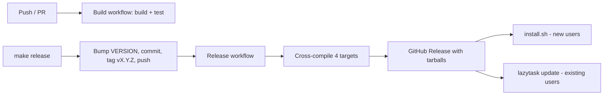

# CI, Release, Deployment & Upgrade Process

lazytask ships as prebuilt binaries for Linux and macOS (amd64/arm64) via
GitHub Releases. Windows is not supported. There is no separate "deploy"
environment: **publishing a GitHub Release is the deployment**.



## 1. Continuous Integration

Workflow: [`.github/workflows/build.yml`](../.github/workflows/build.yml)

- **Triggers:** push to any branch; pull requests targeting any branch.
- **Matrix:** `ubuntu-latest`, `macos-latest` (`fail-fast: false`).
- **Steps:** checkout → Go 1.24.2 → install Taskwarrior (`apt-get install taskwarrior` on Linux, `brew install task` on macOS) → `go build ./...` → `go test ./...`.
- Taskwarrior is installed because tests exercise the real `task` CLI.

Run the same checks locally with `make test` (and `make build`).

## 2. Versioning

- The [`VERSION`](../VERSION) file is the source of truth, in plain `MAJOR.MINOR.PATCH` form (no `v` prefix).
- The project is pre-v1; bump the patch for routine releases.
- The version is injected at build time through
  `-ldflags "-X github.com/tkilb/lazytask/internal/version.Version=<version>"`
  into [`internal/version`](../internal/version/version.go).
- Unreleased local builds (`go build` / `go run`) report `dev`.
- Check the installed version with `lazytask version`, `--version`, or `-v`.

## 3. Cutting a Release

Run from a clean working tree on the branch you want to release (normally `main`):

```bash
make release          # patch bump (default)
make release minor    # minor bump
make release major    # major bump
```

This runs [`scripts/release.sh`](../scripts/release.sh), which:

1. Validates the bump type (`patch|minor|major`).
2. **Refuses to run if the working tree is dirty**, so nothing unrelated gets committed.
3. Requires `VERSION` to be plain `MAJOR.MINOR.PATCH`.
4. Computes the new version and aborts if tag `v<new>` already exists.
5. Writes `VERSION`, commits only that file (`chore: release vX.Y.Z`), and tags it `vX.Y.Z`.
6. Pushes the branch (`git push origin HEAD`) and then the tag.

> [!NOTE]
> This script is the one deliberate exception to the "never auto-commit" convention: the commit is a single mechanical `VERSION` bump tied to the release action.

The script prints the planned version, branch and pushes, then asks for
confirmation (`y` to proceed). Skip the prompt with `RELEASE_YES=1 make release`
or `./scripts/release.sh patch --yes`.

> [!WARNING]
> Make sure CI is green and the branch is correct before confirming. If a
> release fails after the tag is pushed, fix forward with a new patch release
> rather than moving the tag.

## 4. Release Pipeline (Deployment)

Workflow: [`.github/workflows/release.yml`](../.github/workflows/release.yml)

- **Trigger:** push of a tag matching `v*`.
- **Runner:** `ubuntu-latest`, with `contents: write` permission.
- **Steps:**
  1. Checkout and set up Go 1.24.2.
  2. Install Taskwarrior and run `go test ./...`. A test failure stops the release before anything is published.
  3. Derive the version by stripping the leading `v` from the tag.
  4. Cross-compile with `CGO_ENABLED=0` for `linux/amd64`, `linux/arm64`, `darwin/amd64`, `darwin/arm64`, injecting the version via ldflags.
  5. Package each target as `lazytask_<version>_<os>_<arch>.tar.gz`, containing a directory `lazytask_<version>_<os>_<arch>/` with the `lazytask` binary.
  6. Generate `checksums.txt` (`sha256sum *.tar.gz`).
  7. Publish a GitHub Release (`softprops/action-gh-release@v2`) attaching all `dist/*.tar.gz` files plus `checksums.txt`, with auto-generated release notes.

### Artifact naming contract

Both `install.sh` and `lazytask update` construct download URLs from this
exact layout. Changing it breaks upgrades for existing users:

```
https://github.com/tkilb/lazytask/releases/download/v<version>/lazytask_<version>_<os>_<arch>.tar.gz
  └─ lazytask_<version>_<os>_<arch>/lazytask
https://github.com/tkilb/lazytask/releases/download/v<version>/checksums.txt
```

## 5. User Installation (New Users)

```bash
curl -fsSL https://raw.githubusercontent.com/tkilb/lazytask/main/scripts/install.sh | sh
```

[`scripts/install.sh`](../scripts/install.sh):

1. Detects OS (Linux/macOS; rejects Windows) and arch (`amd64`/`arm64`).
2. Queries `https://api.github.com/repos/tkilb/lazytask/releases/latest` for the tag.
3. Downloads the matching tarball and `checksums.txt` into a temp dir, and **aborts on a missing entry or SHA-256 mismatch**.
4. Extracts and installs the binary to `$INSTALL_DIR/lazytask` (default `$HOME/bin`) with mode 755.
5. Warns if `$INSTALL_DIR` is not on `PATH`.

From source: `make install` builds with the `VERSION` file and installs to `$HOME/bin`.

## 6. User Upgrade

```bash
lazytask update
```

Implemented in [`cmd/lazytask/update.go`](../cmd/lazytask/update.go) (`runUpdate`):

1. Rejects Windows.
2. Fetches the latest release tag from the GitHub API (30s HTTP timeout).
3. Compares the running `version.Version` to the latest using numeric `MAJOR.MINOR.PATCH` comparison:
   - Already up to date (current ≥ latest): prints a message and exits.
   - `dev` builds skip the comparison and always update.
4. Downloads `lazytask_<latest>_<os>_<arch>.tar.gz` for the running platform plus `checksums.txt`, verifies the SHA-256 (aborts on mismatch), then extracts the `lazytask` entry in memory.
5. Replaces the running binary: writes a temp file (`.lazytask-update-*`) in the same directory as the executable (symlinks resolved), `chmod 755`, then atomically `rename`s it over the original. This is safe while the binary is running on Linux/macOS.

### Upgrade caveats

- The user needs write permission to the directory containing the binary (e.g. `/usr/local/bin` may need a different install location or `sudo`).
- Checksums come from the same release as the archive, so they catch corruption and partial uploads but not a compromised release. There is no signature verification.
- Releases published before checksums were added have no `checksums.txt`, so `lazytask update` and `install.sh` will fail against them.
- There is no automatic update check on startup; users must run `lazytask update` (or re-run `install.sh`).
- There is no rollback; to downgrade, install a specific release tarball manually from the Releases page.
- Pre-release or draft releases are ignored, since the `/releases/latest` endpoint returns only the latest published non-prerelease.

## Quick Reference

| Task | Command |
| --- | --- |
| Run tests | `make test` |
| Local build | `make build` |
| Install from source | `make install` |
| Release (patch/minor/major) | `make release [minor\|major]` |
| Fresh install | `curl -fsSL .../scripts/install.sh \| sh` |
| Upgrade | `lazytask update` |
| Check version | `lazytask version` |
